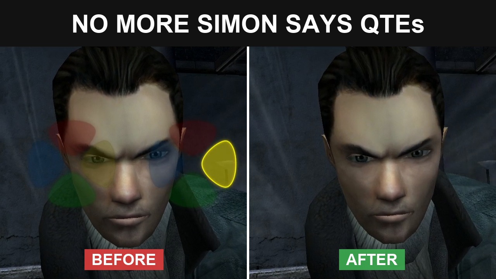

# Fahrenheit: Indigo Prophecy Remastered — Remove Simon Says QTE (Auto-Pass)

**Version 0.1.1 (beta)** · by NeonGamingMods

## Description

Quick Time Events pass on their own, and you never see them.

- Simon Says QTEs (the colored direction prompts) pass automatically. This covers both
  kinds: the ones that affect mental health (e.g. Reconstruction) and the ones where
  failing costs health and can end in a game over (e.g. The Storm).
- QTE graphics, sounds and captions ("GET READY!", "GREAT!", "LUCKY!", "FAILED!") are hidden.
- Normal action prompts and dialog choices still work as usual.

## Video

## Download

Get the zip from the [latest release](../../releases/latest).

## Installation

1. Extract the zip files to the game folder.
2. Double-click `Install.bat`.
3. That is all. Play.

The original exe is also backed up the first time you install.

Double-click `Uninstall.bat` to uninstall the mod.

## Known limits (beta)

- Tested in Reconstruction, Lost Love and The Storm. Let me know if another chapter has problems.
- Meter mini-games (alternating two keys) still have to be played.
- Mood bars and lives counter still show.
- In non-English languages, the "GET READY!" / "GREAT!" / "FAILED!" text may still appear
  (auto-pass still works).

## Requirements

Steam version of the game. Nothing else to install.

## Antivirus warnings

Some antivirus tools and browsers flag batch files that start PowerShell. That's a false
positive. `patch.ps1` is a plain-text script you can read before running: it changes a few
bytes in `FahrenheitSub.exe` (every change is listed at the top of the script) and refuses
to write anything if your files don't match the expected version.

If Windows shows a blue "Windows protected your PC" box when you run `Install.bat`, click
**More info → Run anyway**. Or, before extracting, right-click the zip → **Properties** →
tick **Unblock** → OK.

## Screenshots

| | |
|---|---|
|  |  |
|  |  |
|  |  |
|  |  |

## Support

Found a problem? Open an [issue](../../issues).

## Shout outs

To mah boy Claude Opus 5.5 (Anthropic) for helping with reverse engineering and patch scripts.

## License

The patch scripts (`patch.ps1`, `Install.bat`, `Uninstall.bat`) are released under the
[MIT License](LICENSE).

Not affiliated with Quantic Dream, Aspyr or the game's publishers. No game files are
included in this repository. Fahrenheit: Indigo Prophecy Remastered and its assets are
the property of their respective owners.
