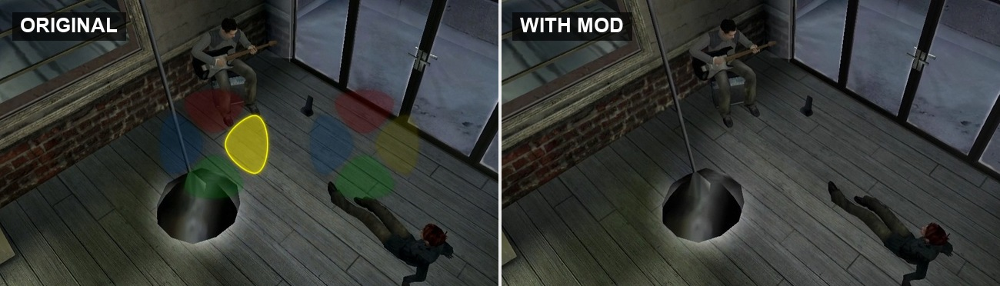
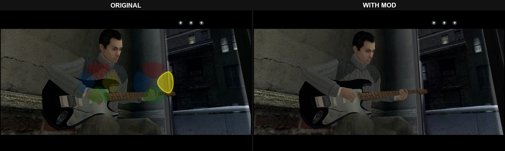
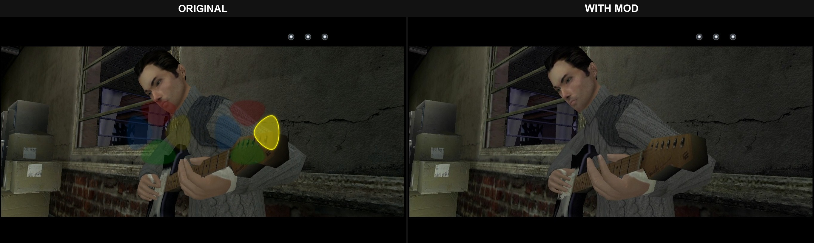
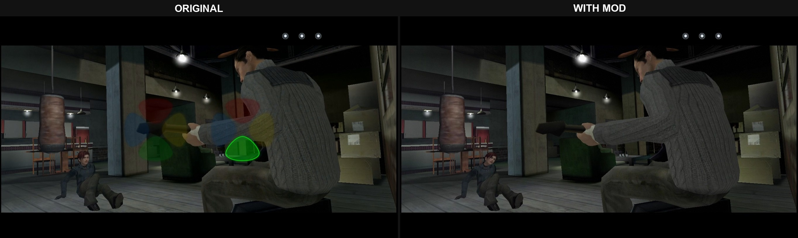
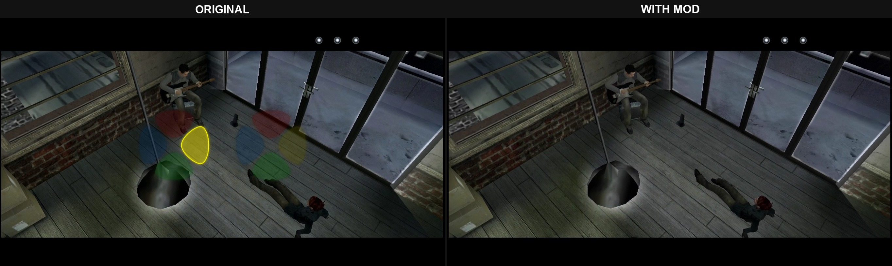
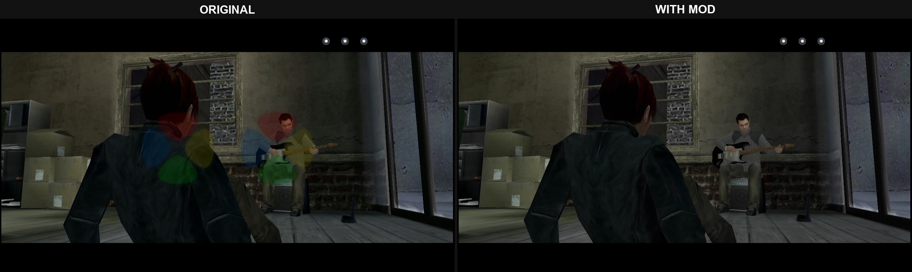
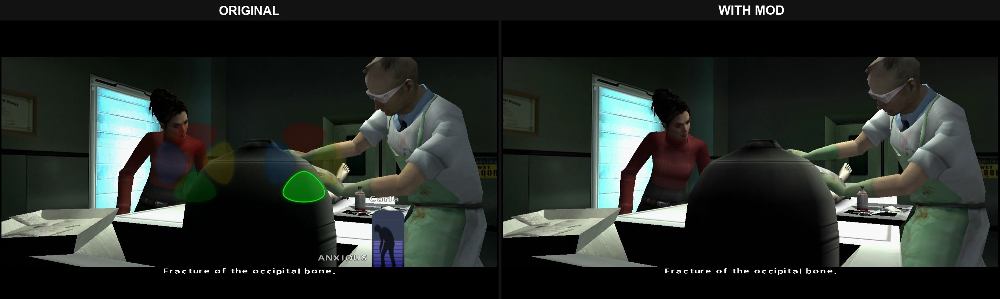
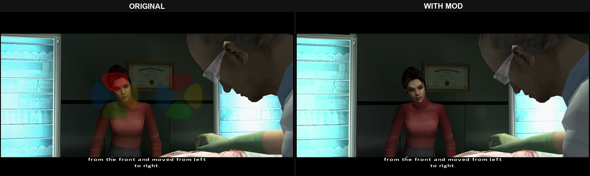
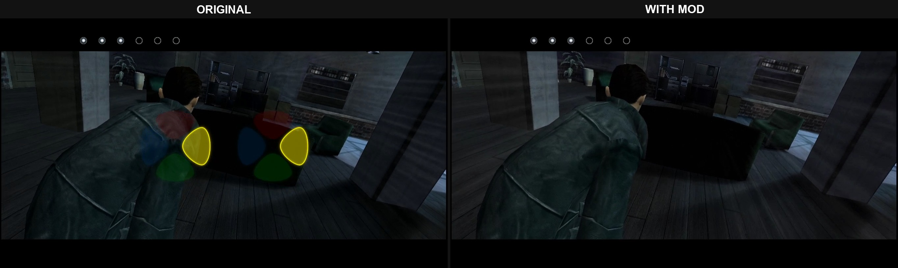

# Fahrenheit: Indigo Prophecy Remastered — Remove Simon Says QTE (Auto-Pass)



**Version 0.1.1 (beta)** · by NeonGamingMods

Quick Time Events pass on their own, and you never see them.

- Simon Says QTEs (the colored direction prompts) pass automatically. This covers both
  kinds: the ones that affect mental health (e.g. Reconstruction) and the ones where
  failing costs health and can end in a game over (e.g. The Storm).
- QTE graphics, sounds and captions ("GET READY!", "GREAT!", "LUCKY!", "FAILED!") are hidden.
- Normal action prompts and dialog choices still work as usual.

## Download

Get the zip from the [latest release](../../releases/latest).

## Install

1. Close the game.
2. In Steam: right-click the game > Manage > Browse local files.
3. Copy the files from the zip into that folder and double-click `Install.bat`.

Your original exe is backed up the first time you install.

## Uninstall

Double-click `Uninstall.bat`, or use Steam's "Verify integrity of game files".

## After a Steam update or Verify integrity

Run `Install.bat` again. If an update changes the game, the patcher won't touch it.

## Known limits (beta)

- Tested in Reconstruction, Lost Love and The Storm.
- Meter mini-games (alternating two keys) still have to be played.
- Mood bars and lives counter still show.
- Captions are only hidden in English.

This is a beta. Future versions may cover more QTE elements.

## Requirements

Steam version of the game. Nothing else to install.

## How it works / antivirus warnings

`patch.ps1` is a plain-text PowerShell script you can read before running. It changes a
few bytes in `FahrenheitSub.exe` (the list of every offset and its original and new
bytes is at the top of the script) and blanks the four QTE captions in
`BigFile_PC.d02`. It refuses to write anything if the files don't match the expected
version. `Install.bat` and `Uninstall.bat` only run that script.

Some antivirus tools and browsers flag batch files that start PowerShell. That is a
false positive; the scripts are short enough to check yourself.

Check which patches are applied (PowerShell, in the game folder):

```
powershell -ExecutionPolicy Bypass -File patch.ps1 -Action Status
```

## Screenshots

| | |
|---|---|
|  |  |
|  |  |
|  |  |
|  |  |

## Support

Open an [issue](../../issues) for bug reports or questions.

## Credits

NeonGamingMods. Made with help from Claude Opus 5.5 (Anthropic).

Not affiliated with Quantic Dream, Aspyr or the game's publishers. No game files are
included in this repository.
